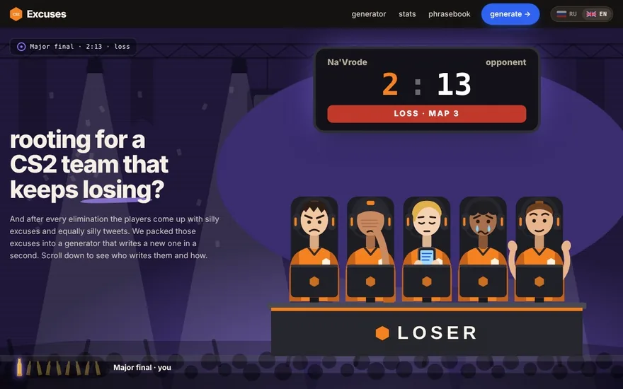
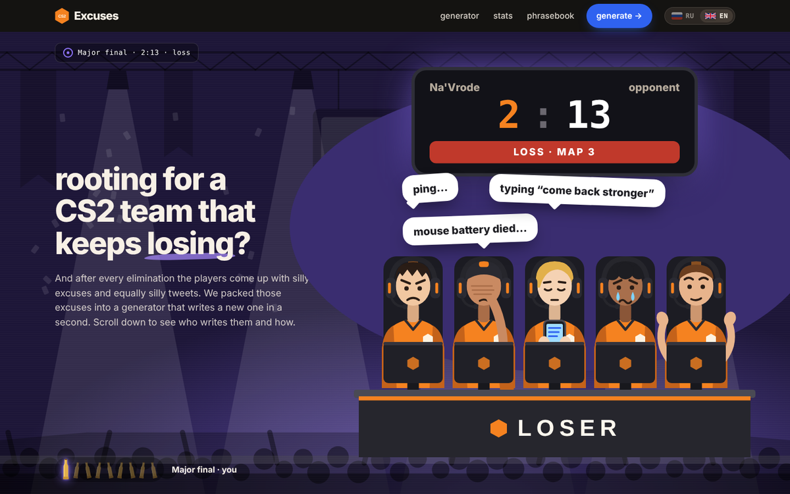
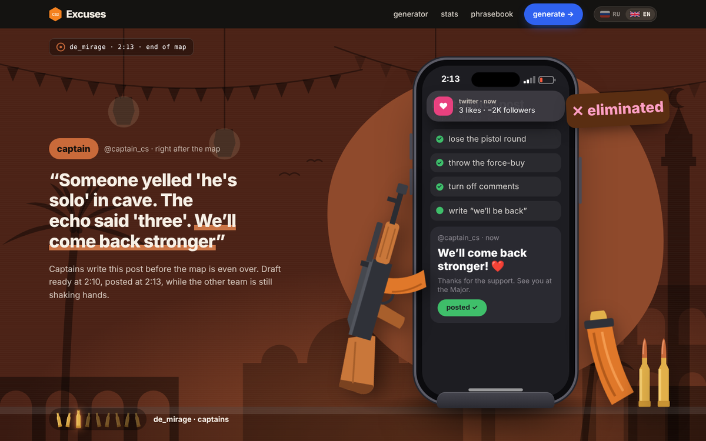
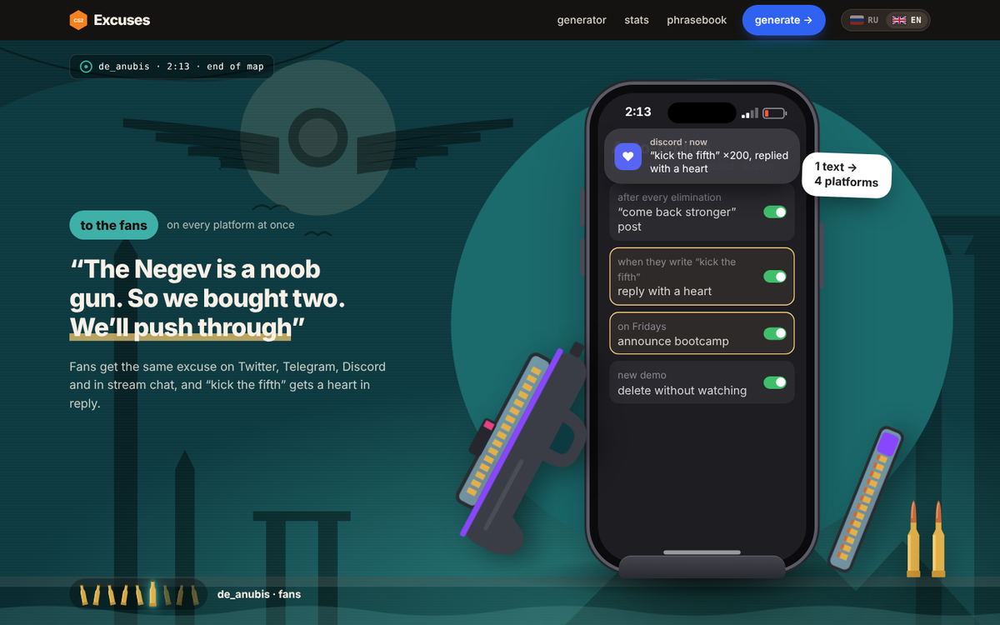
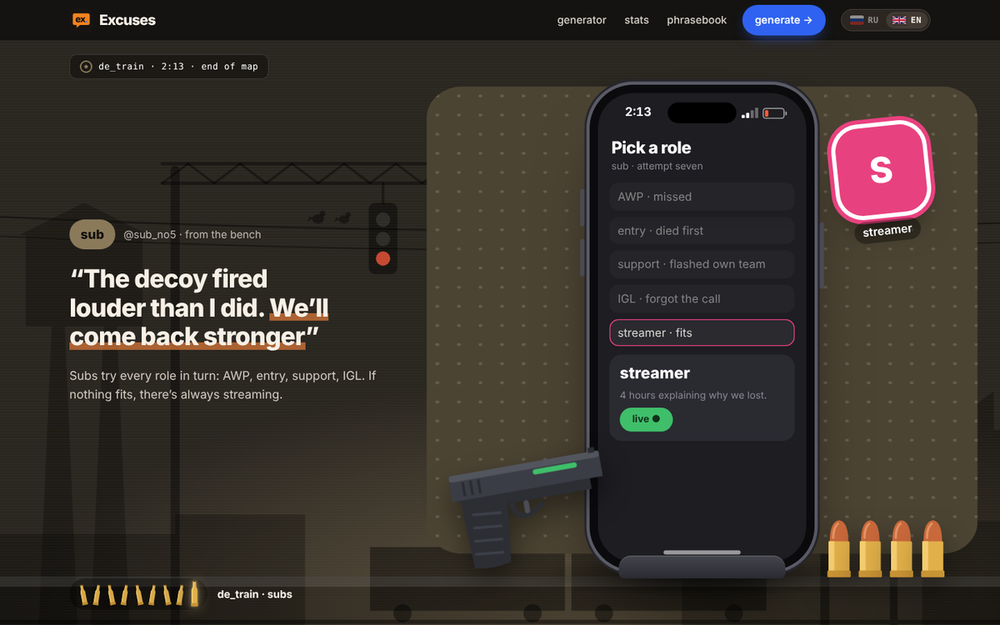
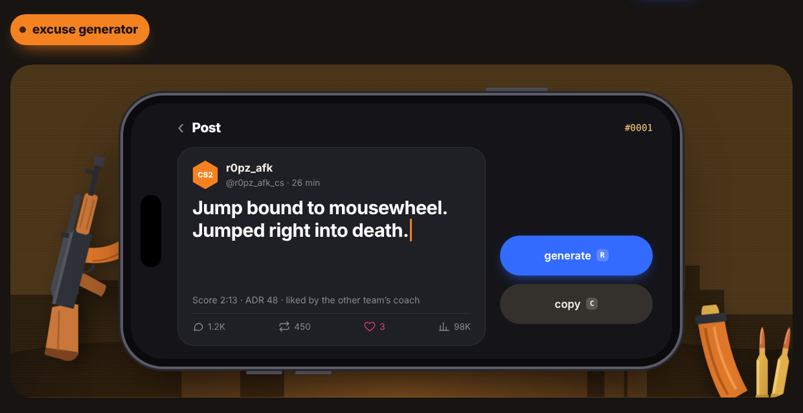
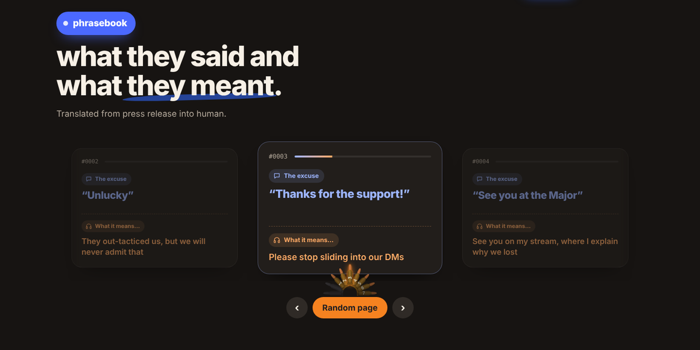
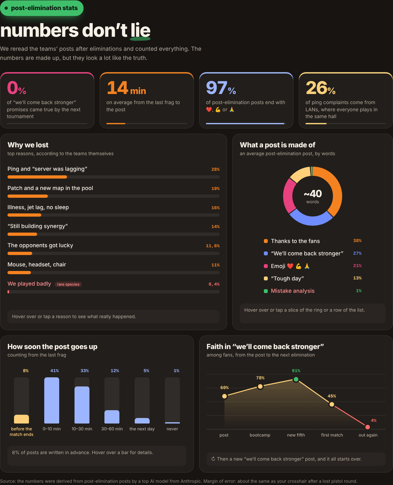
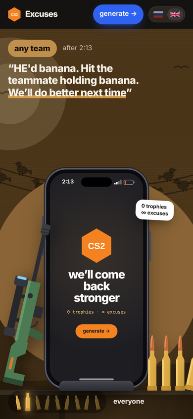

<div align="center">

# Excuses

**A satirical CS2 excuse generator. 0 trophies · ∞ excuses.**

Your team just lost the Major final 2:13? Don't analyse the demo. Just press **generate** and post.

[](https://thayorns.github.io/excuses/)

[](LICENSE)


<br>


<br>


<br>

<a href="https://thayorns.github.io/excuses/"></a>

</div>

---

## What is this?

After every elimination, pro CS2 teams post the same thing: *“Tough day. Thanks for the support. We'll come back stronger ❤️”*. Then they lose again, and the post comes back too.

**Excuses** is a one-page scrollytelling site that collects these excuses, sorts them by who writes them, counts them with completely made-up statistics, and finally automates the whole thing with a generator that writes a fresh post-match excuse in about a second.

It is a single, self-contained `index.html`: no framework, no bundler, no backend, no tracking. Open it and it works.

## Features

### 📱 Excuse generator

- **2000 excuses in Russian and 2000 in English**, combined with random nicknames, scores, ADR and endings.
- The post types itself letter by letter inside a landscape phone, with a blinking caret.
- Font size is fitted to the full text in advance, so lines never jump while typing.
- **Copy** puts the clean post on your clipboard, ready for X / Telegram / Discord.
- Keyboard shortcuts: <kbd>R</kbd> to generate, <kbd>C</kbd> to copy.

### 📊 Post-elimination stats

Four HUD-style numbers and four interactive charts with satirical data (“We played badly — rare species, 0.4%”). Every bar, ring slice and line is driven by scroll position and fills in as you scroll. Hover or tap any item to read what *really* happened.

### 📖 Phrasebook: what they said vs. what they meant

A carousel of **2000 pairs** that translate press-release language into human:

> **“We'll come back stronger”** → Bootcamp starts next week. We'll be playing Dota there.

Auto-play with a progress bar, pause on hover, “Random page” button, and pagination made of a fan of bullets.

### 🌍 Two languages

Full Russian and English versions with a flag switcher. The choice is remembered in `localStorage`, and the page does not flash the wrong language on reload.

### ♿ Details that matter

- Responsive from 320 px phones to wide desktops, with a separate mobile layout for the stage.
- Respects `prefers-reduced-motion`: animations are switched off, charts render in their final state.
- Keyboard navigation and visible focus everywhere, `aria-live` regions for the generated post.
- A few hidden easter eggs. Try clicking things.

## Screenshots

<table>
  <tr>
    <td></td>
    <td></td>
  </tr>
  <tr>
    <td></td>
    <td></td>
  </tr>
  <tr>
    <td></td>
    <td></td>
  </tr>
  <tr>
    <td></td>
    <td align="center"></td>
  </tr>
</table>

## Run locally

No install, no build. Clone and open the file:

```bash
git clone https://github.com/Thayorns/excuses.git
cd excuses
open index.html            # macOS
xdg-open index.html        # Linux
start index.html           # Windows
```

Or serve it if you prefer:

```bash
npx serve .
# or
python3 -m http.server 8000
```

The only external request is Google Fonts (Manrope, Onest, JetBrains Mono). Without network access the page falls back to system fonts.

## Project structure

```
excuses/
├── index.html      # the whole app: markup, styles, scripts and all data
├── assets/         # README screenshots and demo animation
├── LICENSE
└── README.md
```

Inside `index.html`:

- **Inline SVG** for every map, weapon, character and icon, so there are no image requests.
- **CSS** with custom properties per chapter, `@property` for animated colours; the stage scales to fit any viewport.
- **Vanilla JS**: scroll-driven chapter switching, the typing generator, scroll-linked charts, the phrasebook carousel and i18n.

## Deploy

The site is hosted on GitHub Pages straight from the `main` branch root. Any static host works: drop `index.html` on Netlify, Vercel, Cloudflare Pages or an Nginx box.

## Disclaimer

This is **satire**. Team names, nicknames and quotes are parodies and entirely fictional; no real player has ever written any of this (probably). The statistics are made up, with a margin of error comparable to your crosshair after a lost pistol round.

Not affiliated with or endorsed by Valve. Counter-Strike and CS2 are trademarks of Valve Corporation.

## License

[MIT](LICENSE) © 2026 [Valentine Frolov](https://github.com/Thayorns)

<div align="center">

**GG WP.** If it made you laugh, leave a ⭐

</div>
